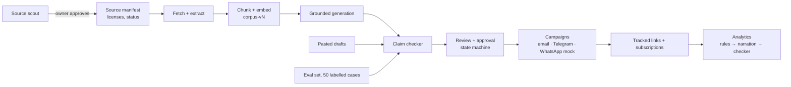

# Architecture

Residual Room is a grounded content and campaign engine for a small AI-education publication. It drafts newsletter issues from an approved, versioned corpus, checks every factual claim against that corpus and the publication's own rules, puts each piece through human review, sends approved pieces to readers, and measures what happens.

The design goal: **every number and claim a reader sees can be traced to a source passage, a rule, or a human decision**, and the system can say how often its own checks are right.

## Principles

- **LLMs only where judgment is needed**: drafting, claim extraction, support checking, relevance ranking, narration. State, scheduling, formatting, licenses, word lists, CTA counts, number matching and statistics are plain code.
- **Grounding is claim-level.** Text is split into atomic claims; each must cite a corpus chunk. Greetings, sign-offs, CTAs, transitions, "read next" pointers and clearly marked opinions are exempt, and the generator's own labels are re-checked rather than trusted.
- **The judge is not the generator**, and they come from different model families, to avoid self-preference bias.
- **The corpus is versioned and immutable.** Every generated piece records the corpus version it was grounded in; superseded sources stay in the corpus so the checker can recognise stale claims.
- **Licenses decide what is published.** Only CC BY, MIT, Apache-2.0 and the publication's own text is committed; everything else is fetched locally and never redistributed.
- **Free infrastructure only**: local embeddings, free LLM tiers, a free web service with a scheduled job instead of a paid worker.

## Components

### Corpus (`src/residual_room/corpus`)
- **Manifest** (`data/sources_manifest.yaml`): every approved source with its license, verification status and current/superseded status. Aliases resolve to canonical ids.
- **Fetch and extract**: arXiv HTML (tables rebuilt with spanned cells filled, so every row keeps its labels), ACL Anthology PDFs, notebooks and docs pinned to a commit SHA. Committable text goes to `corpus/`, the rest to a gitignored folder.
- **Chunking**: split at headings, pack paragraphs to ~400 tokens, never split a table or code block, no overlap, so "which chunk supports this claim" has one answer.
- **Embeddings**: `bge-small-en-v1.5` run locally (ONNX), deterministic, stored in Postgres with pgvector.

### Generation (`src/residual_room/generation`)
Retrieval takes current chunks only, diversified by source so one paper can't crowd out the rest. The generator returns structured segments, each claim citing chunk ids it was actually given. Structure (citations real, one CTA, sign-off, read-next for newer readers) is validated in code with one corrective retry; anything still wrong is kept and blocked by the checker, never silently dropped.

### Checker (`src/residual_room/checker`)
Two layers, one report:
- **Deterministic**: hype word list, CTA count, citations to superseded or unknown sources, "read next" pointers that don't match a real explainer, the correction-notice rule for the first issue after a correction.
- **Judge model**: claim extraction for pasted text; support and number checks against the cited passages (a number must match in value *and* in what it describes); contradiction and staleness checks against the corpus, with the publication's operational docs always in view; policy rules (career promises, predictions as fact, rumours, anthropomorphising, undefined jargon for newer readers).

Every hit carries a rule id, a reason and an evidence chunk. If the judge can't answer, the piece is blocked, not passed.

### Evaluation (`src/residual_room/evaluation`, `eval/`)
50 owner-labelled cases with a frozen dev/test split (hard cases and single-example rules held out in test). Reports lenient and strict accuracy, per-rule precision and recall with raw counts, false positives on clean cases, and every disagreement with the judge's reasons. Results are dated and record the models and corpus version.

### Review and approval (`src/residual_room/workflow`, `web/`)
A pure state machine: draft → checks → in review → approved → scheduled → sent, with reject and edit-as-new-version. Blocking hits must each be overridden with a written reason before approval; refusals and overrides are audited. The review screen shows each sentence with its verdict and the source passage behind it.

### Channels and campaigns (`src/residual_room/channels`)
One content model per approved version, rendered per channel after approval: email (Resend, only to an allow-listed test list, unsubscribe link in every message), Telegram (bot in polling mode, test channel only), WhatsApp (a mock enforcing opt-in, the 24-hour window and approved templates). Every outbound link goes through a redirect that records campaign, segment and channel, and nothing personal.

### Analytics (`src/residual_room/analytics`)
Every number is a row in one table, real and seeded data kept apart. Insights come from rules with a minimum sample (two-proportion z-tests, trend and spike detection), and below it the screen says "not enough data". The LLM only narrates detected insights; every number it states must appear in a row it cites, seeded data must be labelled as such, and the narration goes through the same claim checker as newsletters.

### Source scout (`src/residual_room/scout`)
Proposes new sources for a topic: the LLM writes search queries and ranks results, searches and license resolution are deterministic (ACL Anthology, arXiv's own license records, GitHub's license API). Proposals never enter the manifest on their own; the owner approves each one, and approved sources become a new corpus version.

## Data model (Postgres)
`corpus_versions`, `sources`, `chunks` (pgvector) · `pieces`, `piece_versions`, `check_runs`, `overrides`, `audit_log` · `generation_jobs` · `subscribers`, `campaigns`, `deliveries`, `links`, `clicks` · `metric_rows`, `narrations`. Migrations in `migrations/`.

## Deployment
One Docker web service on Render's free tier (API plus the built screens, behind HTTP Basic auth), Postgres on Neon, and a scheduled GitHub Actions job that calls a token-protected endpoint every 10 minutes to send due campaigns and poll Telegram, standing in for a paid background worker.

## Where to look next
- `docs/decisions.md`: every architectural decision, with the reason and the evidence that prompted it, including what went wrong and how it was fixed.
- `eval/results/`: dated evaluation reports.
- `docs/brand-guide.md`, `docs/content-policy.md`: the rules the generator and checker share.
